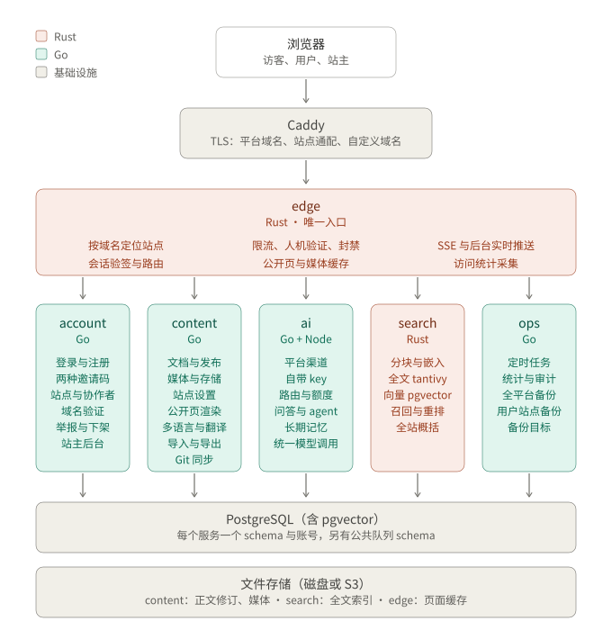
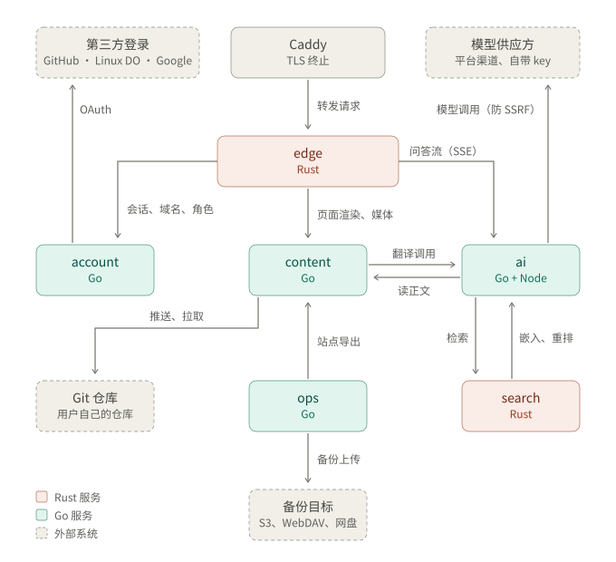
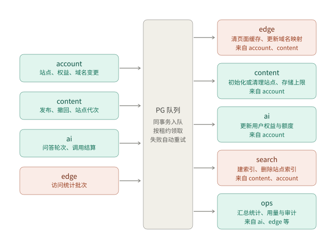

# 新架构设计：多用户文档平台（草案）

- 日期：2026-10-27。状态：已定稿。
- 现行 16 服务实现保存在分支 `archive-16-services`。新架构在 main 上分阶段改造，复用现有代码，不重复造轮子。
- 现有正式站保持现状，不迁移数据。

## 1 目标与范围

把单站点文档站改成类似 GitBook 的多用户平台。平台上有四类人：

| 角色 | 说明 |
|---|---|
| 站主 | 平台运营者，即初始化时注册的超管。管理平台设置、用户、两种邀请码、举报、平台 AI 渠道和全平台备份 |
| 用户 | 注册后直接拥有站点，默认最多 5 个 |
| 协作者 | 被站点所有者邀请参与某个站点，角色为编辑或只读 |
| 访客 | 阅读公开站点；访问私有站点需要协作者身份、密码或分享链接 |

第一版范围：

- 现有单站点的全部功能，按站点提供给每个用户：编辑、发布、历史、多语言、问答、长期记忆、统计、风控。
- 新增功能：
  - 第三方登录和两种邀请码
  - 子域名与自定义域名
  - 自带 key、AI 邀请码和按用户计的额度
  - 举报与下架、私有站点
  - 导入、Git 同步
  - 用户自备份、站主全平台备份

不做：

- 多地部署
- 自部署安装包
- 国内网盘
- 实时协同
- 在线支付

## 2 已确认的决定

| 方面 | 决定 |
|---|---|
| 部署 | 单机，Docker Compose |
| 服务 | edge、account、content、ai、search、ops，共 6 个 |
| 语言 | edge、search 用 Rust；其余用 Go；问答 agent 沿用 ZCode Node 运行时 |
| 数据库 | 全部关系数据进同一个 PostgreSQL，每个服务独立 schema 和账号；正文修订文件、媒体、索引文件在磁盘或 S3 |
| 初始化 | 保留现有初始化流程。密钥、存储、备份目标、第三方登录凭证、DNS 令牌都在后台填写，不手改配置文件 |
| 登录 | GitHub、Linux DO、Google 第三方登录直接建号，首次登录可选填 AI 邀请码 |
| 邮箱注册 | 需要注册邀请码，不验证邮箱。公开注册开关默认关闭，接口照写 |
| 站点 | 用户直接拥有站点，没有组织层，可邀请协作者；角色为所有者、编辑、只读 |
| 默认限额 | 每个用户 5 个站点、1 GB 存储（名下站点共用），站主后台可改；访客问答每站每天 50 次，站点所有者可改 |
| 域名 | 子域名用通配证书；自定义域名由 Caddy 按需签证书；平台域名和站点域名部署前再定，在站主后台填写 |
| Git 同步 | 发布时推送到用户仓库，需要时在后台手动拉取成草稿 |
| AI 默认 | 用户自带 key；嵌入向量由平台统一提供 |
| AI 邀请码 | 站主生成，指定：花费上限、可用模型、额度周期、有效期与可用次数、站点数与存储上限。新码替换旧码 |
| AI 额度 | 按用户计，名下站点共用。先用自带 key，失效或余额不足时自动切到平台额度 |
| 备份 | 目标为 S3 兼容、WebDAV、海外网盘。站主做全平台备份，用户也能备份自己的站点 |
| 合同 | 保留每个服务的 OpenAPI 和代码生成；事件只登记名称、版本和载荷；不再维护函数级 implementation.json |

## 3 总体结构

图中 edge 到五个服务的箭头，是后台和公开接口的转发。

- **两个可注册域名分开**：
  - 平台域名（示例 `app.example.com`）承载后台、登录和站主后台。
  - 站点域名（示例 `<站点名>.example.net`）只承载公开站点。

  这样用户站点的内容碰不到后台 cookie。站点域名申请加入 Public Suffix List，防止站点之间互写 cookie。具体域名部署前再定，在站主后台填写，代码不写死。
- **edge 是唯一入口**：负责按域名找到站点、会话验签、路由到各服务、缓存和限流。业务都在各自服务里执行，每个服务仍按 site_id 和角色复核权限。

## 4 服务划分

| 服务 | 语言 | 职责 | 拥有的数据 | 主要来源（复用） |
|---|---|---|---|---|
| edge | Rust | 见下方展开 | 封禁、风控策略、风险事件 | portal、traffic-guard、public-site 的缓存、analytics 的采集；按现有 Go 实现的行为用 Rust 重写 |
| account | Go | 见下方展开 | 用户、身份绑定、会话、站点登记、协作者、域名、两种邀请码、用户权益、举报、平台设置 | identity、site-config 的平台部分 |
| content | Go | 见下方展开 | 文档、修订、发布、编辑锁、媒体、站点设置、译文与术语、Git 同步配置 | content、media、public-site、site-config 的站点部分、localization、data-protection 的 Git 镜像 |
| ai | Go + Node | 见下方展开 | 渠道、自带 key、额度账本、调用记录、对话与轮次、长期记忆 | model-gateway、qa、agent、memory |
| search | Rust | 见下方展开 | 分块、向量（pgvector）、全文索引文件 | knowledge；按现有 Go 实现的行为用 Rust 重写 |
| ops | Go | 见下方展开 | 任务定义与执行记录、统计汇总、审计、备份目标与备份记录 | jobs、analytics、data-protection |

各服务职责展开：

- **edge**
  - 按域名定位站点，提供 Caddy 的 ask 接口
  - 会话 access token 本地验签，按路由表转发
  - 限流、人机验证、封禁
  - 公开页和媒体缓存
  - SSE 透传，把后台实时事件推给浏览器
  - 采集访问统计
- **account**
  - 用户、第三方登录、邮箱注册、会话
  - 注册邀请码和 AI 邀请码（也就是用户权益）
  - 站点登记（站点名、所有者、状态）与站点数上限
  - 协作者邀请与角色
  - 域名验证
  - 举报与下架
  - 平台设置和站主后台接口
- **content**
  - 文档树、块、草稿、发布、撤回、回收站、历史
  - 媒体与存储上限
  - 站点设置（首页、品牌、页脚、公告、可见性、密码、分享链接）
  - 公开页渲染
  - 多语言数据与翻译编排
  - 导入、导出、Git 同步
- **ai**
  - 平台渠道与用户自带 key
  - 模型路由与额度账本
  - 问答（对话、流式、引用、记录）及 ZCode agent 运行时
  - 长期记忆
  - 统一的调用接口：给 content 翻译、search 嵌入和描述用
- **search**
  - 分块、调用 ai 生成嵌入
  - 全文索引（tantivy）、向量检索（pgvector）、混合召回与重排
  - 全站概括
- **ops**
  - 定时任务、进度、取消、重试和死信管理
  - 统计汇总与查询、审计
  - 全平台备份与用户站点备份
  - 存储目标管理（S3、WebDAV、海外网盘授权）

划分原则：

- 翻译编排放在 content，因为它紧贴修订和人工保护数据；ai 只提供带路由和额度的模型调用。
- 摘要、视觉描述由 search 编排，同样调 ai。
- 问答需要的检索和读正文，分别调 search 和 content。

## 5 用户、站点与权限

### 5.1 登录与注册

- **第三方登录**：GitHub、Google（OIDC）、Linux DO（OAuth2）。首次登录直接建号，并可选填 AI 邀请码。一个账号可以绑定多个第三方身份；不按邮箱自动合并账号，避免被冒领。
- **邮箱注册**：需要注册邀请码，不验证邮箱。公开注册开关在站主后台，默认关闭。
- **站主**：沿用初始化时的密码登录。
- **凭证**：各登录方式的客户端凭证由站主在后台填写，未填的登录方式不显示。

### 5.2 站点与角色

- 站点由用户直接拥有，有三种状态：正常、已下架、已删除。
- 站点数和存储上限来自用户权益。默认每个用户 5 个站点、1 GB 存储（名下站点共用），默认值站主可在后台修改。
- 站点内有三种角色：
  - 所有者：管站点设置、协作者、域名和删站。
  - 编辑：能写，也能发布。
  - 只读：用于私有站点的阅读。
- 每个业务表都带 `site_id`，用户级数据带 `user_id`。所有查询以 site_id 为必填参数；跨站点访问在服务的查询层就被拒绝。第一版不启用 PostgreSQL 行级安全。

### 5.3 会话与跨域访问

- 后台会话 cookie 只在平台域名上（host-only）。edge 用 account 的公钥在本地验证 access token（EdDSA，≤15 分钟）；刷新时走 account。
- **私有站点**：站点在另一个域名上，拿不到后台 cookie，所以按访问方式分别处理：
  - 协作者：跳转到平台域名确认身份，带一次性码回到站点域名，edge 换取该站点专用的短期 cookie。
  - 密码访问：在站点域名上输入密码换取 cookie。
  - 分享链接：带令牌的链接换取 cookie。
- **公开站点**：访客只有 edge 签发的伪名访客身份，用于限流和问答会话。这沿用现有做法。

### 5.4 举报与下架

- 访客可在任意站点页提交举报。站主在后台处理：驳回、下架站点或封禁用户。
- 下架后，edge 对该站点返回下架提示页；封禁用户会连带下架其全部站点。

## 6 域名与入口

- **平台域名**：普通证书。
- **站点通配域名**：用 DNS 验证签通配证书。Caddy 需要带对应 DNS 服务商模块构建。DNS 令牌由站主在后台填写，account 通过 Caddy 管理接口下发，不写进配置文件。
- **自定义域名**：
  1. 用户在站点设置中填写域名。
  2. 系统给出 TXT 验证值和指向方式：子域名用 CNAME，根域名用 A 记录指向本机。
  3. 验证通过后，域名标记为已验证。
  4. 首次 HTTPS 握手时，Caddy 调 edge 的 ask 接口，确认是已验证域名才签证书。
  5. 已验证域名定期复核；失效的停止续期并通知用户。
- **主地址**：站点同时有子域名和自定义域名时，子域名 301 到自定义域名，保证 SEO 只有一个主地址。
- **站点名规则**：维护保留名单（www、app、api、admin、mail 等）；站点名修改有冷却期；删站后站点名保留一段时间再释放。
- **edge 缓存域名映射**：缓存"域名 → 站点（含状态、可见性、生成代次）"，收到 account 和 content 的事件后失效。

## 7 数据与存储

### 7.1 PostgreSQL

- **实例**：一个 PostgreSQL，带 pgvector 扩展。
- **schema 隔离**：每个服务一个 schema、一个数据库账号，只授权本 schema。服务之间不读对方的表，跨服务只走 API 和事件。
- **公共队列 schema**：`queue` 是基础设施，只通过平台库访问。
- **SQL**：Go 用 pgx + sqlc；Rust 用 sqlx。迁移按服务存放，只追加。
- **在 PG 里的数据**：
  - 会话、额度预留与结算、队列、访问统计、向量这类高并发、高频的数据
  - 文档元数据、站点设置这类低频数据

  全部进 PG 之后，一次数据库备份就是全平台一致的快照。现行的跨域屏障、封口、快照、换目录恢复协议因此整体删除。

### 7.2 文件

| 文件 | 所有者 | 说明 |
|---|---|---|
| 正文修订文件 | content | 内容寻址，只增不改，仍是正文权威 |
| 媒体 blob | content | SHA256 内容寻址，现有实现已按站点分目录 |
| 全文索引 | search | 可从 PG 与修订文件重建，不进备份 |
| 页面与媒体缓存 | edge | 可丢弃 |

- 存储后端默认是本机磁盘，站主可在后台切换到 S3 兼容存储。
- 未被引用的文件超过保留期才清理，保证备份期间引用的文件一定在。

### 7.3 密钥

以下密钥都存在 PG，用信封加密：

- 用户自带 key
- 平台渠道 key
- 第三方登录凭证
- DNS 令牌
- 备份目标凭证

主密钥和服务签名密钥在首次启动时自动生成，放在部署机的私有卷里，不进库、不进 git。用户只在后台填写，从不手改文件。

## 8 服务间通信

上图只画服务之间、以及服务和外部系统之间的直接调用；后台接口经 edge 的转发见第 3 节总览图。图中省略了三处次要调用：

- search 收到发布事件后，回 content 读取发布内容。
- account 通过 Caddy 的管理接口下发 DNS 令牌。
- Caddy 签自定义域名证书前，先问 edge 该域名是否已验证。

通信方式：

- **同步调用**：HTTP/JSON。每个服务的 `contracts/openapi.json` 是唯一来源，Go 和 Rust 的服务端接口与客户端都由它生成。
- **服务身份**：保留短期服务断言（Ed25519，签发方、目标、有效期，带用户委托上下文）。单机内网下，去掉请求体哈希绑定和防重放。
- **事件与任务**：统一走 PG 队列，Go 与 Rust 共用一套。
  - 生产方在业务事务内直接入队（同库不同 schema，同一事务），不再需要 outbox 转发和 jobs 中转。
  - 消费方读取时带可见超时，作为租约；读取次数用来计重试；本地事务里记已处理的事件 ID 去重，再确认。
  - 延迟消息用于退避和定时。
- **定时任务**：登记、进度、取消、死信与重放的管理由 ops 负责，执行由各服务的 worker 拉取。
- **实时推送**：后台实时事件由各服务通过 PG NOTIFY 发出，edge 监听后推给浏览器 SSE；问答流由 ai 产生，edge 透传。

各服务的操作审计也以事件形式交给 ops，图中写作"来自 ai、edge 等"。

主要事件：

| 生产方 | 事件 |
|---|---|
| account | 用户创建、站点创建/更新/下架/删除、协作者变更、权益变更、域名验证/移除 |
| content | 发布变更、撤回、站点代次变更、资源引用变更 |
| ai | 问答轮次完成/失败、调用结算 |
| search | 索引就绪 |
| edge | 访问统计批次（由 ops 汇总） |
| ops | 备份状态 |

## 9 AI 设计

### 9.1 渠道与路由

- **两类渠道**：
  - 用户自带：OpenAI 兼容地址 + key，可覆盖 OpenRouter、DeepSeek 等。
  - 平台渠道：站主配置。
- **路由顺序**：用户自带 key（该任务已配置时）→ 失败时自动切到平台额度（只在鉴权失败、余额不足或限额这类错误时切）→ 都没有则报"缺能力"。
- **流式输出不中途换模型**：已经输出文本的回答，不切换模型重答。这沿用现有规则。
- **嵌入**：统一用站主配置的平台嵌入模型，费用由平台承担，不计入用户额度。换嵌入模型等于全平台重建，需要站主批准。

### 9.2 AI 邀请码与额度

| 字段 | 说明 |
|---|---|
| 花费上限 | USD micros 整数，沿用现有费用账本口径 |
| 额度周期 | 一次性或按月重置 |
| 可用模型 | 按任务指定：问答、翻译、记忆助手等 |
| 有效期、可兑换次数 | 码本身的使用限制 |
| 站点数上限、存储上限 | 写入用户权益，由 account 执行站点数、content 执行存储 |

- **兑换**：用户兑换新码时，新码替换旧码，旧码权益关闭、剩余额度作废。
- **账本**：额度账本在 ai，按用户计，名下站点共用。沿用现有"预留 → 结算、未知费用保守保留"的账本逻辑，并发预留用行锁保证不超额。
- **访客问答花谁的钱**：访客在用户站点上提问，花的是站点所有者的 key 或额度。
- **访客问答的防护**：每个访客由 edge 限流；每个站点另有每日上限，默认每天 50 次，站点所有者可在站点设置里修改。达到上限后当天暂停访客提问，并在后台提示所有者。

### 9.3 自带 key 的安全

- **能力探测**：添加 key 时探测工具调用、上下文窗口、流式等能力，并标出可用于哪些任务。
- **防 SSRF**：
  - 出站前解析地址，拒绝私网、环回、链路本地和云元数据地址。
  - 连接时校验实际 IP，防 DNS 重绑定。
  - 不跟随跳到这类地址的重定向。
- **不回显**：key 保存后不再回显，只显示后四位。日志不记录 key 和提问正文。

## 10 检索（search，Rust）

- **入库**：content 发布事件 → 回 content 读取发布内容 → 分块（移植现有分块规则）→ 向 ai 请求嵌入 → 写入全文索引和 pgvector。
- **全文**：所有站点共用一个 tantivy 索引，中文用 jieba 分词，以 site_id 字段过滤。
- **向量**：pgvector，按 site_id 过滤检索。
- **查询**：BM25 + 向量混合召回，RRF 融合，可选调用 ai 重排。每次查询必须带 site_id 和可见性条件，由 Rust 层强制。
- **重建**：全文索引可由 PG 与修订文件完整重建。

## 11 edge（Rust）

- **公开页**：缓存键是"站点、站点代次、语言、路径"。未命中时请求 content 渲染（复用现有 Go 模板），渲染结果再缓存；发布或站点设置变化时站点代次加一。私有站点先校验访问权，再使用同一份缓存。
- **媒体**：按 SHA256 内容寻址，不可变，缓存在磁盘并按 LRU 清理。
- **限流与风控**：令牌桶放在内存（单实例）；封禁和策略存在 edge 的 schema。人机验证移植现有机制；风控后台接口由 edge 提供。
- **统计**：访问记录在内存里攒批，作为事件交给 ops 汇总。日志和统计都不保存原始 IP。

## 12 导入、Git 同步与备份

- **导入**（content）：支持 Markdown 目录、GitBook 仓库（SUMMARY.md、.gitbook.yaml 及其特有块语法）、Notion 导出包。导入内容统一转成现有块格式，并清洗 HTML。
- **Git 同步**（content）：发布时推送到用户仓库；需要时在后台手动从仓库拉取，生成草稿再发布。自动双向同步以后再做。
- **站点导出**：格式为 Markdown + 块 JSON + 媒体 + 站点设置。它同时是用户备份格式和导入格式。
- **全平台备份**（ops，站主）：先导出 PG，再增量复制正文修订与媒体文件，写到备份目标，可选加密。恢复时停机，导入数据库和文件后再启动。
- **用户站点备份**（ops）：用户在自己的后台配置目标（S3、WebDAV、海外网盘），按计划导出名下站点；恢复就是导入。
- **备份目标的授权**：网盘的 OAuth 授权流程在后台完成。

## 13 前端

- 仍是一个 pnpm 工程，React 19 + HeroUI v3。
- 用户后台在平台域名上：
  - 我的站点列表
  - 进入站点后沿用现有各管理页，加上站点切换
  - 账户与登录绑定、AI 设置（自带 key、兑换码、用量）、备份目标
- 站主后台：用户、两种邀请码、举报、平台设置（域名、登录凭证、DNS、存储）、平台渠道、全平台备份、任务、统计。
- 公开站沿用现有外观和交互岛（问答、语言、明暗）。

## 14 部署

- **单机 Compose**，容器有：
  - caddy（带 DNS 模块）
  - postgres（带 pgvector）
  - edge、account、content、ai（内含 Node agent 进程）、search、ops
- **数据卷**：postgres、content 文件、search 索引、edge 缓存、caddy 证书、私有密钥卷。
- **首次启动**：自动生成主密钥和服务签名密钥，之后进入现有初始化向导，其余配置都在后台填写。
- **构建与发布**：编译、检查、冒烟仍在 NL 编译机。NL 需要先装 Rust 工具链（该机磁盘紧张，装前确认）。不再发布自部署安装包，镜像只给自己的服务器用。

## 15 分阶段改造（都在 main 上）

每个阶段结束时，都能在 NL 测试实例上跑通。

1. **合并**：16 个服务合成 account、content、ai、ops 四个 Go 服务；portal 和 knowledge 暂时保留作为入口和检索；存储暂时不动。目标是现有单站点功能照常可用。
2. **换库**：各服务存储层迁到 PG，所有表加 site_id 或 user_id。事件和任务改走 PG 队列；删除 jobs 中转、outbox 转发和跨域屏障快照协议；删除 implementation.json。
3. **Rust**：edge 替换 portal，并接管公开页缓存、限流、统计采集；search 替换 knowledge。
4. **多用户**：第三方登录、两种邀请码、站点登记与上限、子域名、自定义域名、协作者、私有站点、站主后台。
5. **AI 分层**：自带 key、AI 邀请码、按用户额度与路由、访客问答上限。
6. **运营与数据**：举报下架、导入、Git 同步、备份目标、用户站点备份与全平台备份。

## 16 调研

调研是设计的重要部分：开工前先按领域查已有开源实现。不一定是专做这件事的项目，很多项目的源码里有可用的部分。

- **调研规则**：
  - 每项调研写清项目、许可证、语言、活跃度，以及可借用的源码位置。
  - 定下用法：作为依赖、复制代码（标注出处），还是只参考。
  - GPL 系项目只参考，不复制（Docmost 社区版编辑器扩展这一例外除外）。
  - 采用前读原始 LICENSE，并登记 THIRD_PARTY_NOTICES.md。
- **调研结论与用法**（许可证以各项目原始 LICENSE 为准；采用的依赖已登记 THIRD_PARTY_NOTICES.md）：

| 领域 | 项目与许可证 | 结论与用法 |
|---|---|---|
| S3、WebDAV | rclone（MIT，Go，数十种后端）、Apache OpenDAL（Apache-2.0，Rust）、minio-go（Apache-2.0）、gowebdav（BSD-3）、emersion/go-webdav（MIT） | **自己实现**：备份只要写入、列出、删除三个操作，S3 用 AWS Signature V4（约 100 行，已用 aws-sdk-go-v2 的官方签名器在临时测试里逐字核对，不引入该依赖），WebDAV 用 PUT/MKCOL/PROPFIND/DELETE。出站地址过 libs/platform/netguard（防 SSRF，拨号前再查一次实际 IP）。库的体积与传递依赖不划算 |
| 海外网盘 | rclone 的 Google Drive、OneDrive、Dropbox 后端（MIT）；各家官方 OAuth API | **本期未做**。方案：备份目标接口已按 kind 扩展，网盘走 OAuth 授权后用 rclone 作库（MIT）或官方 API 写入；凭据同样加密存 PG |
| 备份格式与增量 | Kopia（Apache-2.0）、restic（BSD-2）、rustic（Apache-2.0/MIT） | **只参考**。当前每次备份是完整的站点导出包（清单、块 JSON、Markdown、媒体，zip），站点一般不大；数据量上去后再换增量去重（可接 restic 兼容仓库）。平台级备份用 `deploy/backup.sh`（pg_dump 在线导出 + 文件卷打包） |
| 国内网盘（后续） | OpenList / AList（AGPL-3.0）、aliyunpan（Apache-2.0）、BaiduPCS-Go（Apache-2.0）、115driver（MIT） | **后续版本**。OpenList 只参考驱动实现不复制；优先对接各家官方开放平台 |
| 第三方登录 | golang.org/x/oauth2（BSD-3）、coreos/go-oidc（Apache-2.0）、goth（MIT） | **自己实现**：GitHub、Google、Linux DO 三家都是标准授权码流程，只需要换令牌与读用户信息；用 netguard 客户端出站，state 与回跳由 identity 签名。三家的端点以官方文档为准。库的抽象反而多出配置项，暂不引入 |
| 自定义域名证书 | Caddy 按需证书（Apache-2.0）、certmagic（Apache-2.0） | **采用 Caddy 的 `on_demand_tls`**：`ask` 指向 portal 的 `/_tls/allow`，只给平台域名、部署时配置的域名、已验证的自定义域名和平台子域名签证书。用户子域名多了以后，Let's Encrypt 对同一注册域名每周 50 张新证书的限额会成为瓶颈，届时改用带 DNS 模块的 Caddy 签泛域名证书 |
| AI 额度与兑换码 | one-api（MIT）、new-api（AGPL-3.0）、doyensec/safeurl（Apache-2.0） | **只参考**模型与做法：邀请码额度、按用户记账、自带渠道优先；SSRF 防护按 safeurl 的思路自己写成 netguard（保存前解析检查 + 拨号时按实际 IP 再查）。new-api 只参考，不复制 |
| edge | pingora（Apache-2.0）、axum / hyper（MIT）、governor（MIT）、moka（MIT/Apache-2.0）、maxminddb（ISC） | **采用 hyper 1 + tokio**（MIT）自己写：缓存、单飞、令牌桶、流式透传都很小；pingora 过重。国家库仍由 Go 侧 portal 用 maxminddb-golang 查 |
| 检索 | tantivy（MIT）、jieba-rs（MIT）、tantivy-jieba（MIT）、pgvector（PostgreSQL License）、Meilisearch（MIT，对照） | **采用 tantivy + pgvector**。分词由 Go 侧（沿用现有切词）完成，search 只收词，避免在 Rust 里重复一套词典；向量索引按维度建 HNSW。Meilisearch 作对照，未采用（单独的数据副本、多租户隔离更难） |
| PG 队列 | pgmq（PostgreSQL License）、River（MPL-2.0）、apalis（MIT） | **暂不换**。现有 outbox → jobs → inbox 已按站点分发且稳定，换队列收益小；保留，后续如要合并服务再评估 pgmq |
| 导入 | goldmark（MIT）、comrak（BSD-2）、jomei/notionapi（BSD-2）、BookStack（MIT）、Docmost（AGPL-3.0） | **采用 goldmark**（GFM 表格、删除线、任务列表）；GitBook 的 `` 标签先改写成标准 Markdown，Notion 导出按“页面名 + 32 位 ID”的目录约定重建层级。Notion 官方 API 不用（导出包就是 Markdown）。BookStack 与 Docmost 只参考导入行为，不复制 |
| Git 同步 | go-git（Apache-2.0）、gitoxide（Apache-2.0/MIT） | **采用 go-git**（内存克隆、提交、推送，不落盘、不依赖 git 命令）；出站 HTTP 走防 SSRF 的客户端 |
| Rust 的 OpenAPI 代码生成 | — | **不生成**：两个 Rust 服务的接口很少（search 三个、edge 一个清缓存接口），手写请求体并在入口校验；服务间认证用共享密钥 HMAC |

## 17 对现有规则的修改

定稿时已写入 AGENTS.md：

- **架构底线**：
  - "事件经 jobs 中转（outbox → jobs → inbox）"改为"事件和任务经 PG 队列，同事务入队"；阶段 2 换库前沿用现有 jobs 中转。
  - "服务之间不共享可写目录或业务表"保留，并补充"共用一个 PG 实例，每服务独立 schema 与账号"；阶段 2 换库前沿用现有 SQLite。
  - "公共机制只在 libs/platform"改为"Go 在 libs/platform，Rust 在 Rust 平台库"。
  - 新增"多用户数据按 site_id / user_id 隔离"。
  - "正文文件是权威数据"保留。
- **合同**：不再维护函数级 implementation.json；events.json 只登记事件名称、版本和载荷。
- **总则**：开工前加读本文；ADR 和合同里的技术设计与本文冲突时，以本文为准。

尚未执行：requirements.md、architecture.md、protocols.md 等描述 16 服务的文档，在阶段 2 完成后标注为旧架构，或移入归档目录。

## 18 实现状态与偏差（2026-10-27）

与上文设计相比，当前代码的实际状态如下；没写的部分按设计实现。

- **服务划分**：portal 与 knowledge 仍是独立进程（edge 放在 portal 前面，没有取代它；search 是 knowledge 的 Rust 检索后端）；account、content、ai、ops 四个宿主进程各跑一组组件。Rust 服务与 Go 之间用共享密钥 HMAC 认证，没有用服务断言（密钥在部署的私有卷里）。
- **数据与事件**：全部数据在一个 PostgreSQL，租户隔离用行级安全（会话变量 `nw.site`）；事件仍是 outbox → jobs → inbox，按站点分发，没有换成 PG 队列。旧的跨域屏障、封口、快照协议代码还在但不再参与运行，没有删除。
- **用户与站点**：注册（邀请码，不验证邮箱）、第三方登录（只写代码，没有联调）、站点上限与存储上限、成员角色、平台子域名与自定义域名（DNS 验证）、私有站点（一次性码换站点专用短期凭据）、举报与下架都已实现并在 NL 测试实例上验证。邮件相关（验证、通知）没有做。
- **AI**：自带渠道优先、平台兜底、AI 邀请码额度、访客问答每日上限、按用户记账都已实现并用假供应方与 OpenRouter 免费模型验证。
- **统计**：访问信标、小时与日聚合按站点分别计数、分别查询；费用统计只给平台站点，站点主人的 AI 用量走 identity 的 `readAiUsage`。
- **edge**：已实现页面缓存（默认 10 秒 TTL，上游说 no-cache 也按短缓存处理）、单飞、令牌桶限流、流式透传、按域名清缓存接口；还没有接到“发布后立即清缓存”，人机验证、访问记录攒批、媒体磁盘缓存也还留在 portal。
- **导入、导出、备份、Git**：Markdown、GitBook、Notion、本站导出包导入（导入的都是草稿）；整站导出；S3 与 WebDAV 备份目标（手动、每天、每周、保留份数）；Git 推送（只含已发布内容，发布后自动推送）与拉取。海外网盘 OAuth、增量备份、站点级一键恢复（恢复就是导入导出包）之外的在线全平台恢复没有做；全平台备份用 `deploy/backup.sh` 与 `deploy/restore.sh`。
- **部署**：`scripts/gen_deploy.py` 生成每个进程的 Dockerfile、编排、Caddyfile（按需证书）、密钥初始化与备份恢复脚本；已在 NL 上用 `docker compose` 实际构建全部镜像并起了一套（不含 Caddy，经 edge 访问），跑通首次初始化、发布、公开页、多用户建站和按需证书询问。发布流程（`scripts/release.sh` 与 GitHub Actions）还是旧的 16 服务拓扑，尚未适配，Rust 镜像的交叉编译也没有处理。
